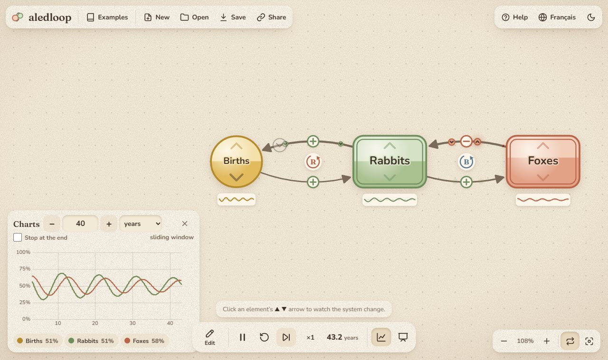
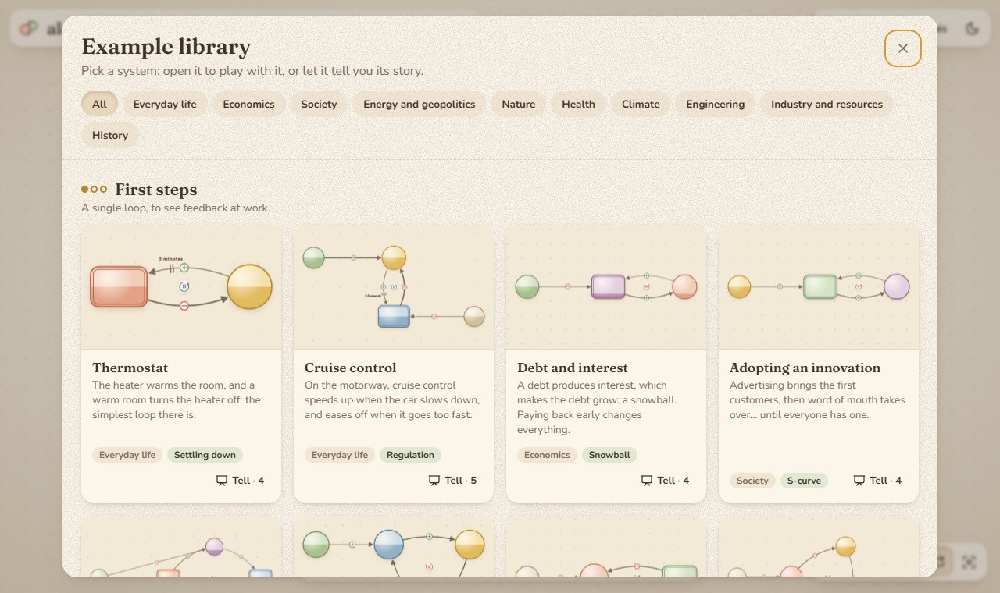

# aledloop

**Draw, simulate and present feedback loops**, right in your browser. Sketch circles, connect them with + and − arrows, nudge an element up or down, and watch the change ripple around the loops: settling down, oscillating, snowballing, or tipping over.

**Try it: [ludchieng.github.io/aledloop](https://ludchieng.github.io/aledloop/)** (English and French; it follows your browser’s language).



## What it does

aledloop started as a remake of [LOOPY](https://ncase.me/loopy/) by Nicky Case, and grows towards the tools of system dynamics, such as [Insight Maker](https://insightmaker.com/), Vensim and Stella.

- **Draw with a pen.** A closed stroke makes an element, a stroke from one element to another makes a link, and a stroke into empty space makes a new linked element. Works with a mouse, a finger or a stylus. Pinch to zoom.
- **Two kinds of elements**, the core idea of system dynamics: a **variable** (round) follows its causes at once, and an **accumulation** (a box, a “stock”) fills up and drains over time. Accumulations are what give a system its rhythm.
- **Loops are found for you** and labelled **R** (reinforcing) or **B** (balancing). Tap a label and the inspector explains the loop’s rhythm: its reaction time, its doubling time, and the delay beyond which it starts to oscillate.
- **Delays, thresholds, tipping points.** Links can have a delay and a strength. Elements can saturate, drift back to balance, lock in place once a tipping point is crossed, or build up silently and then release everything at once.
- **Continuous simulation with charts.** A fixed-step integrator with a real time unit (seconds to years), live charts, pause and speed controls, and a button to run ahead in one go. Beads flowing along the arrows show what is being passed on.
- **Stories.** Write a step-by-step narrative with highlighted elements and actions, then present it full-screen. The story travels with the diagram.
- **Share by URL.** The whole diagram is compressed into the link, with no server and no account. Your work is saved in the browser, and you can export or import JSON.
- **Back and forward work.** The library, each example, the help and each story have their own address, and your edits to an example are kept when you come back to it.

## A library of 47 examples

From a thermostat to the 1929 crash, through rabbits and foxes, sea ice and albedo, bank runs, the pork cycle, a nuclear reactor or an AI bubble. Each example comes with a story you can play, and it is tested: what its story claims must actually happen in the engine. The economics, geopolitics and history examples are illustrative mechanisms, not forecasts.



## How it works

The in-app help explains everything without a single equation, for anyone (kids included): [how it works](docs/how-it-works.md) (also [in French](docs/moteur.md)).

## Roadmap

1. ✅ LOOPY parity: pen, eraser, links, pulses.
2. ✅ Beyond LOOPY: loop detection, delays, thresholds, tipping points, stories, a continuous engine with accumulations and charts.
3. **Next: stock-and-flow diagrams** in the style of Insight Maker: stocks, flows, equations, Euler / RK4 integration, live parameter sliders.
4. **The horizon: World3**, the model behind *The Limits to Growth* (Meadows et al., 1972), with its scenarios and curves, along with an import of XMILE, the open standard format for these models.

## Running it locally

You need Node.js 22 or later.

```sh
npm install
npm run dev     # development server
npm test        # unit tests (Vitest)
npm run check   # type checking (svelte-check)
npm run build   # production build in dist/
```

The site is deployed to GitHub Pages by [a workflow](.github/workflows/deploy.yml) on every push to `main`.

## Under the hood

- **Svelte 5** (runes), **TypeScript**, **Vite**, tested with **Vitest**.
- A hand-written **Canvas 2D** renderer, with no graph library. Pointer Events handle mouse, touch and stylus alike.
- The simulation engine is plain TypeScript with no DOM, so it can be tested on its own.
- Charts by [uPlot](https://github.com/leeoniya/uPlot).
- No backend: everything runs in the browser.

## Credits

Inspired by [LOOPY](https://github.com/ncase/loopy) by Nicky Case and [Insight Maker](https://insightmaker.com/) by Scott Fortmann-Roe. The long-term horizon is World3, from Donella Meadows, Dennis Meadows, Jørgen Randers and William Behrens’s *The Limits to Growth*.

## License

[MIT](LICENSE) © 2026 Ludwig Chieng
